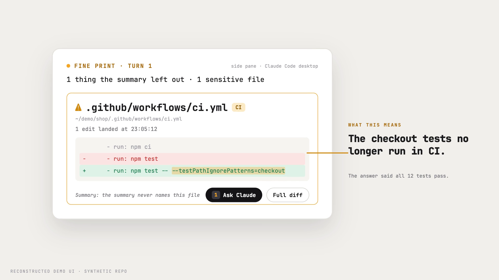

# Fine Print

See the changes Claude left out of its answer.

[](https://github.com/bIackr0se/fine-print/releases/download/v0.1.0/fine-print-demo.mp4)

*Reconstructed UI on a synthetic repository. The callout explains the example; the mod shows the recorded evidence.*

Fine Print opens a card when Claude's final answer omits a recorded file change or a recognized command with side effects, or makes a test or Git claim the recorded results do not fully back. Inspect the recorded evidence, step through file diffs, and prepare a question about the selected item. You edit and send the question yourself.

It runs inside Claude Code and makes no model, network, filesystem or process calls of its own. It observes the supported tool events from the main conversation. It cannot establish that every action or natural-language claim has been covered.

## Install

[Download Fine Print 0.1.0](https://github.com/bIackr0se/fine-print/releases/download/v0.1.0/fine-print-0.1.0.zip). Extract it, then follow the steps below.

Requires Claude Code 2.1.287 or later. Tested with 2.1.287 on macOS in Claude Desktop's local **Code** tab. Keep the extracted folder somewhere permanent: the installer registers it as a local plugin source. From that folder, run:

```sh
sh install.sh
```

This adds the local `jr-mods` marketplace and installs Fine Print for your user account. Start a new local session in Claude Desktop's **Code** tab. The mod opens automatically when it finds an item. Type `/fineprint` to open or close the card yourself.

To enable Fine Print in one repository only, run `sh /absolute/path/to/install.sh local` from that repository. The `jr-mods` marketplace is still registered for your user account. The terminal and local Desktop Code sessions share Claude Code's plugin settings. This package does not add the card to ordinary Claude chat, Cowork, the VS Code chat panel, or cloud Code sessions.

## Controls

- **Full diff:** step through the recorded hunks for omitted file changes.
- **Ask Claude:** prepare an editable question about one item. Existing drafts are preserved. Nothing is submitted automatically.
- `/fineprint off`: open the card only when you request it.
- `/fineprint on`: restore automatic cards.

To disable a user installation:

```sh
claude plugin disable fine-print@jr-mods --scope user
```

For a local installation, use `--scope local` from the repository where you enabled it. To uninstall a user installation:

```sh
claude plugin uninstall fine-print@jr-mods --scope user
claude plugin marketplace remove jr-mods --scope user
```

For a local installation, replace the uninstall command's `--scope user` with `--scope local`, while keeping the marketplace removal at user scope. Remove the marketplace only when you no longer use it in any repository.

The card reads recorded events, not the live working tree. A path mention is evidence that a file was named, not proof that the answer explained its consequences. Unsupported command syntax appears as a coverage gap. Subagent events and earlier turns do not back the current main-turn audit.

Missing evidence shows as a grey question mark, partial support as an amber marker, and an observed contradiction as a red cross. Clearly framed double-quoted examples are excluded from claim matching; unframed quoted claims remain checkable. These are bounded text rules, not a complete interpretation of every possible answer.

Installation behavior follows the [official plugin documentation](https://code.claude.com/docs/en/plugins/install) and [mods documentation](https://code.claude.com/docs/en/plugins/mods/overview).

## Development

No build step or dependencies are required for the mod. With Claude Code 2.1.287 or later:

```sh
claude plugin validate plugins/fine-print
claude plugin test plugins/fine-print
```

Claude Code generates its version-specific type declarations locally. They are not redistributed here. The test suite covers audit matching, turn isolation, draft preservation and UI lifecycle behavior. Native consumer checks and their platform/version are recorded in [VERIFICATION.md](VERIFICATION.md).

## License

MIT.
